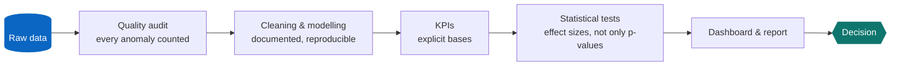
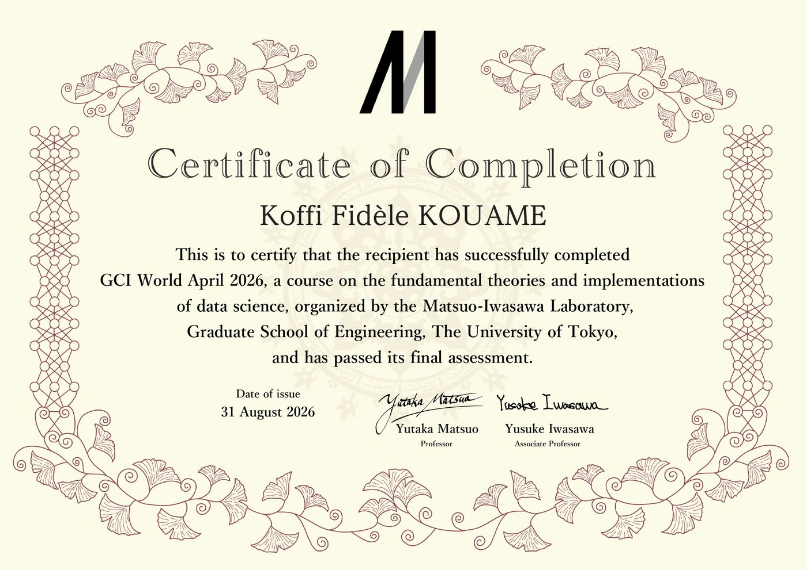
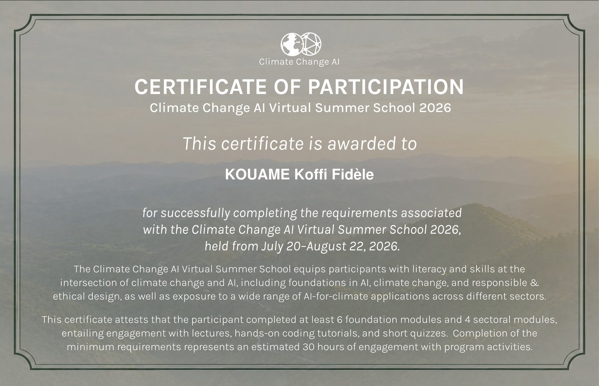
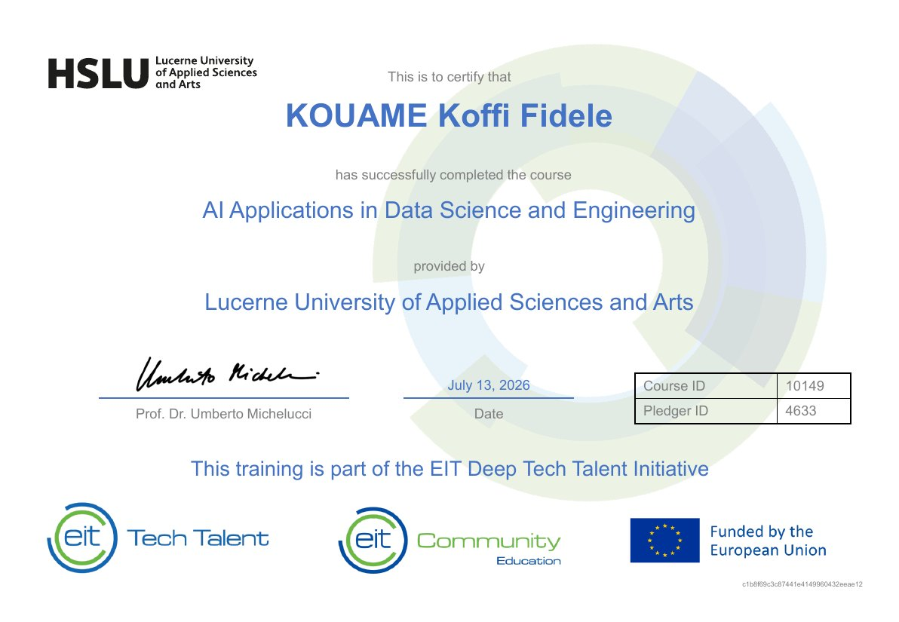
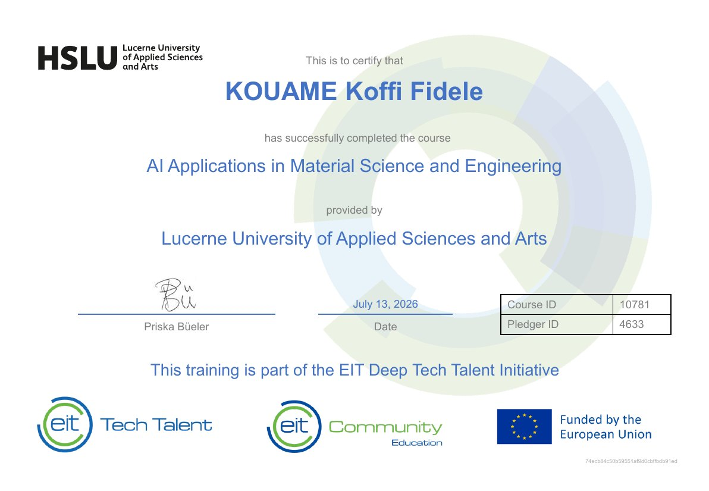
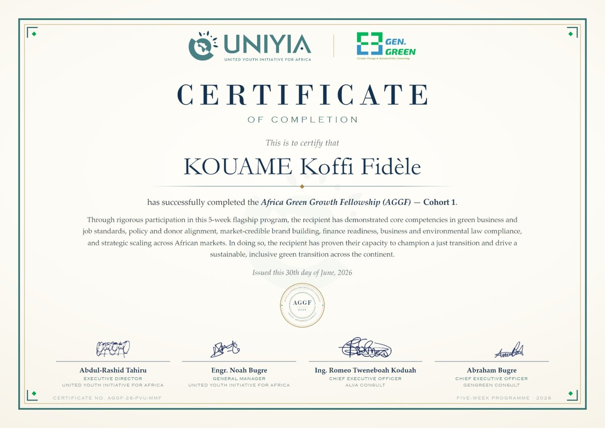
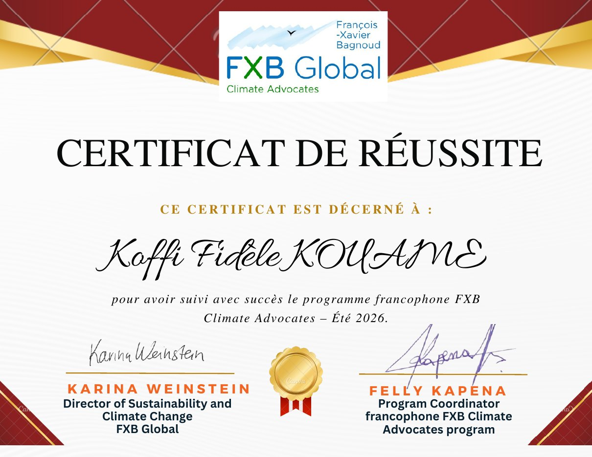
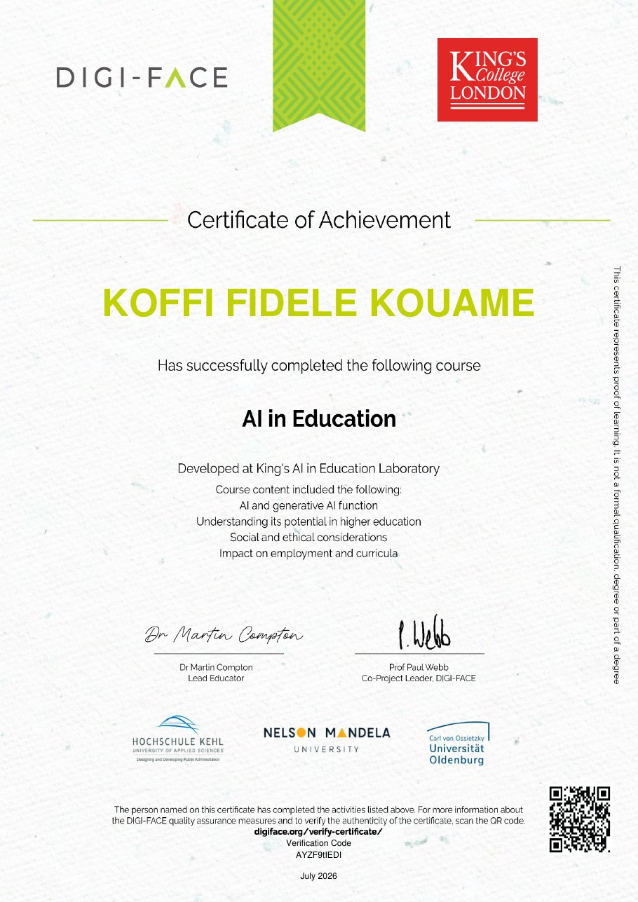
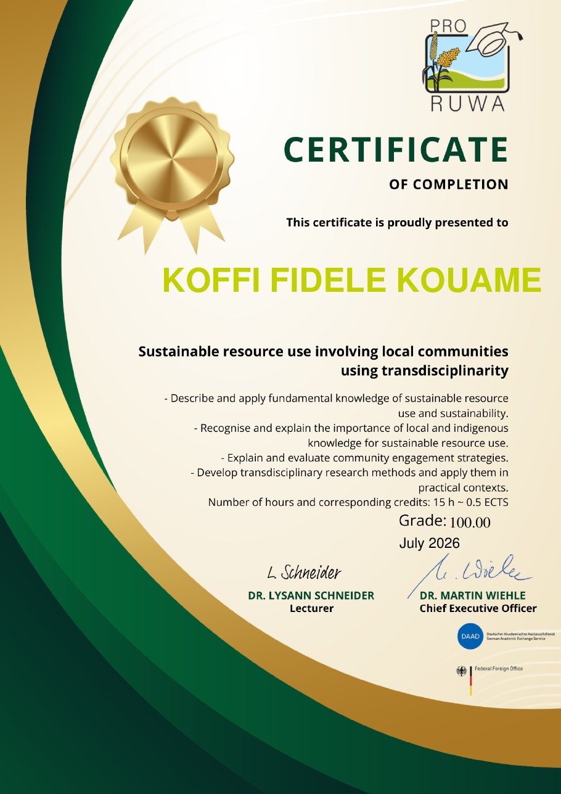
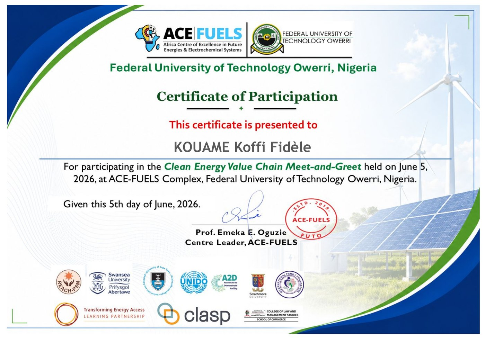

<p align="center">
  
</p>

<p align="center">
  <a href="#projects">
    
  </a>
</p>

<p align="center">
  <a href="https://www.linkedin.com/in/koffi-fidele-kouame/"></a>
  <a href="mailto:koffifidelek59@gmail.com"></a>
  <a href="https://github.com/koffifidelek59-collab?tab=repositories"></a>
  <a href="https://github.com/koffifidelek59-collab"></a>
</p>

<p align="center">
  
  
</p>

<p align="center">
  <a href="certificates/01_GCI_World_University_of_Tokyo.jpg"></a>
  <a href="certificates/02_Climate_Change_AI_Summer_School.jpg"></a>
  <a href="certificates/03_HSLU_AI_Data_Science_Engineering.jpg"></a>
  <a href="certificates/05_AGGF_Africa_Green_Growth_Fellowship.jpg"></a>
</p>

<p align="center">
  <a href="#about"><b>About</b></a> &nbsp;•&nbsp;
  <a href="#impact"><b>Impact</b></a> &nbsp;•&nbsp;
  <a href="#projects"><b>Projects</b></a> &nbsp;•&nbsp;
  <a href="#internship"><b>Internship</b></a> &nbsp;•&nbsp;
  <a href="#energy"><b>Energy & AI</b></a> &nbsp;•&nbsp;
  <a href="#certifications"><b>Certifications</b></a> &nbsp;•&nbsp;
  <a href="#skills"><b>Skills</b></a> &nbsp;•&nbsp;
  <a href="#collab"><b>Contact</b></a>
</p>

---

<a name="about"></a>
##  Hello, I'm Koffi

<table>
<tr>
<td width="56%" valign="top">

**Electrical engineer turned energy-systems and data analyst.**

I build the full chain that turns raw data into a decision: quality audit, validated model, statistical evidence and a dashboard that a manager can act on. I apply the same rigour to **renewable energy, green hydrogen and power systems**, where engineering knowledge and data science must work together.

> **In one line:** I make data trustworthy, measure what matters, and show the evidence behind every recommendation.

</td>
<td width="44%" valign="top">

```yaml
name:     KOUAME Koffi Fidèle
role:     Energy Systems & Data Analyst
master:   Energy & Green Hydrogen
          (System Analysis), WASCAL
engineer: Master 2 Electrical Eng.,
          Automation & Computer Science
now:      Data Analysis Internship,
          VOLTIX 2026
based:    Abidjan · Niamey
speaks:   French (native), English (professional)
open_to:  [roles, internships, research]
```

</td>
</tr>
</table>

<table align="center">
  <tr>
    <td align="center" width="33%"><br><strong>Recruiting?</strong><br><sub>Start with the <a href="#projects">featured projects</a> and <a href="#how">how I work</a>, then <a href="https://www.linkedin.com/in/koffi-fidele-kouame/">connect on LinkedIn</a>.</sub></td>
    <td align="center" width="33%"><br><strong>Research or energy?</strong><br><sub>See <a href="#energy">energy, climate and AI</a> and my <a href="#focus">current focus</a>.</sub></td>
    <td align="center" width="33%"><br><strong>Collaborating?</strong><br><sub>Read <a href="#collab">how we can work together</a> and write to me.</sub></td>
  </tr>
</table>

---

##  What I bring to a team

<table>
  <tr>
    <td width="50%" valign="top">
      <strong>📐 Analytical rigour</strong><br>
      <sub>Every number is traceable: documented cleaning rules, explicit KPI bases, effect sizes alongside p-values, limitations stated. I check the data before I trust it: mixed date formats, placeholder values, target leakage.</sub>
    </td>
    <td width="50%" valign="top">
      <strong>📊 Decision-ready delivery</strong><br>
      <sub>Power BI, Excel and interactive HTML dashboards, LaTeX reports and executive summaries that non-specialists can use.</sub>
    </td>
  </tr>
  <tr>
    <td width="50%" valign="top">
      <strong>⚙️ Engineering background</strong><br>
      <sub>Electrical engineering, automation and AI-based fault diagnosis of induction motors: I understand the systems behind the data.</sub>
    </td>
    <td width="50%" valign="top">
      <strong>⚡ Energy domain knowledge</strong><br>
      <sub>Solar PV sizing, Power-to-X pathways, electrolysis, hydrogen safety and energy-system modelling.</sub>
    </td>
  </tr>
</table>

---

<a name="impact"></a>
##  Impact at a glance

<table align="center">
  <tr>
    <td align="center" width="16%"><br><sub>medical appointments<br>analysed</sub></td>
    <td align="center" width="16%"><br><sub>accuracy: AI fault diagnosis<br>of induction motors</sub></td>
    <td align="center" width="16%"><br><sub>video-game releases<br>modelled</sub></td>
    <td align="center" width="16%"><br><sub>films<br>analysed</sub></td>
    <td align="center" width="16%"><br><sub>AUC: NFL draft model<br>(GCI World, U. Tokyo)</sub></td>
    <td align="center" width="16%"><br><sub>certificates and<br>courses in 2026</sub></td>
  </tr>
</table>

---

<a name="experience"></a>
##  Experience

| | Role | Organisation | What I did |
| :-: | :-- | :-- | :-- |
| 📊 | **Data Analysis Intern**<br><sub>2026</sub> | VOLTIX | Twelve end-to-end projects: cleaning, statistics, Power BI, Excel and HTML dashboards, LaTeX reports ([see below](#internship)) |
| 🤖 | **Research Intern**<br><sub>2025 · 6 months</sub> | Lab-Tech Laboratory, Félix Houphouët-Boigny University, Abidjan | AI-based fault diagnosis of squirrel-cage induction motors: **96.3 % accuracy** with an MLP (Python, TensorFlow, scikit-learn), experimental validation and thesis |
| 🏆 | **ML competitor**<br><sub>2026</sub> | GCI World, Matsuo-Iwasawa Laboratory, University of Tokyo | NFL draft prediction for 3,477 college players: CatBoost, XGBoost and Extra Trees, **OOF AUC 0.8315** (bootstrap, DeLong test); target leakage diagnosed and fixed, unit tests for reproducibility |
| 📚 | **Freelance tutor**<br><sub>2019 to 2025</sub> | Self-employed, Abidjan | Physics, chemistry and mathematics; exam preparation (BEPC, BAC) |

---

<a name="projects"></a>
##  Featured projects

<sub>Click any picture to open the project.</sub>

<table>
  <tr>
    <td width="50%" valign="top">
      <a href="https://github.com/koffifidelek59-collab/video-game-analytics">
        
      </a>
      <h3>🎮 <a href="https://github.com/koffifidelek59-collab/video-game-analytics">Video Game Market Analytics</a></h3>
      <p><strong>What sells in the video game market?</strong> Genres, platforms, publishers and regions, 1980 to 2016.</p>
      <ul>
        <li>16,715 releases of 11,563 games, 99.97 % of units kept after cleaning</li>
        <li>Market peak in 2008, then -60 % of tracked retail sales by 2015</li>
        <li>Critic score linked to sales (ρ = 0.39), still 0.26 after controlling for visibility</li>
        <li>8-page Power BI dashboard · 22 DAX measures</li>
      </ul>
      <a href="https://colab.research.google.com/github/koffifidelek59-collab/video-game-analytics/blob/main/Video-Game-Analytics.ipynb"></a>
      
      
      
    </td>
    <td width="50%" valign="top">
      <a href="https://github.com/koffifidelek59-collab/movie-analytics">
        
      </a>
      <h3>🎬 <a href="https://github.com/koffifidelek59-collab/movie-analytics">Movie Analytics</a></h3>
      <p><strong>What drives the success of a film?</strong> End-to-end pipeline, statistical tests and a seven-page interactive Power BI dashboard.</p>
      <ul>
        <li>3,754 films (1960 to 2015): two TMDb sources joined, audited and traced in Power Query</li>
        <li>Median ROI 2.27x; 76.6 % of films recover their budget</li>
        <li>Spearman and Kruskal-Wallis tests, effect sizes reported</li>
        <li>22 DAX measures · 19-page LaTeX report</li>
      </ul>
      <a href="https://colab.research.google.com/github/koffifidelek59-collab/movie-analytics/blob/main/Movie-Analytics.ipynb"></a>
      
      
      
    </td>
  </tr>
  <tr>
    <td width="50%" valign="top">
      <a href="https://github.com/koffifidelek59-collab/healthcare-noshows">
        
      </a>
      <h3>🏥 <a href="https://github.com/koffifidelek59-collab/healthcare-noshows">Healthcare No-Shows Analytics</a></h3>
      <p><strong>Why do patients miss their appointments?</strong> Data quality, KPIs and statistics, entirely in Excel.</p>
      <ul>
        <li>106,987 appointments, 60,268 patients; no-show rate 20.3 %</li>
        <li>Same-day booking 4.7 % no-show vs 28.5 % when booked ahead</li>
        <li>SMS effect isolated with a Mantel-Haenszel odds ratio (0.78)</li>
        <li>Two dashboards: formula-driven and pivot with slicers · 14-page report</li>
      </ul>
      
      
      
    </td>
    <td width="50%" valign="top">
      <a href="https://github.com/koffifidelek59-collab/customer-analytics">
        
      </a>
      <h3>🛒 <a href="https://github.com/koffifidelek59-collab/customer-analytics">Customer Analytics</a></h3>
      <p><strong>Data quality as a system.</strong> Automated ETL, quality gate, KPIs, statistical tests and an interactive dashboard on a purchase register.</p>
      <ul>
        <li>2,150 raw rows audited and validated to 2,100</li>
        <li>Quality gate with alerts and notifications</li>
        <li>Daily Airflow DAG, Prometheus and Grafana monitoring</li>
        <li>Interactive HTML command center and report</li>
      </ul>
      <a href="https://colab.research.google.com/github/koffifidelek59-collab/customer-analytics/blob/main/Customer-Analytics.ipynb"></a>
      
      
      
      
    </td>
  </tr>
  <tr>
    <td width="50%" valign="top">
      <a href="https://github.com/koffifidelek59-collab/weather-analysis">
        
      </a>
      <h3>🌦️ <a href="https://github.com/koffifidelek59-collab/weather-analysis">Weather Analysis</a></h3>
      <p><strong>What does nine years of one station's weather say?</strong> Validation, seasonality and trend testing.</p>
      <ul>
        <li>3,271 daily records (2008 to 2017), 162 missing calendar days detected</li>
        <li>A wrong date format would have silently lost about 60 % of the rows</li>
        <li>Temperature trend +1.51 °C per decade (p = 0.020) on complete years</li>
        <li>Power BI dashboard with reliability-aware metrics</li>
      </ul>
      <a href="https://colab.research.google.com/github/koffifidelek59-collab/weather-analysis/blob/main/Weather_Analysis.ipynb"></a>
      
      
      
    </td>
    <td width="50%" valign="top">
      <a href="https://github.com/koffifidelek59-collab/sales-dashboard-task2">
        
      </a>
      <h3>💰 <a href="https://github.com/koffifidelek59-collab/sales-dashboard-task2">Sales Cleaning, Validation & Dashboard</a></h3>
      <p><strong>Is the sales file really dirty, and what does it say?</strong> Validation before analysis.</p>
      <ul>
        <li>26,397 sales lines, three arithmetic identities checked to one cent</li>
        <li>34.4 % of lines have no customer key: customer metrics scoped honestly</li>
        <li>An IQR screen would have removed 39 % of revenue: rejected</li>
        <li>Self-contained HTML dashboard with cross-filtering</li>
      </ul>
      
      
      
    </td>
  </tr>
</table>

<!--
  NYC AIRBNB: remove these two comment lines once the repository nyc-airbnb-analytics is on GitHub.
<p align="center">
  <a href="https://github.com/koffifidelek59-collab/nyc-airbnb-analytics"></a><br>
  <b>🗽 <a href="https://github.com/koffifidelek59-collab/nyc-airbnb-analytics">NYC Airbnb Analytics</a></b> · 48,645 listings · price model (R² = 0.52) · 7-page Power BI dashboard · 44 DAX measures
</p>
-->

---

<a name="internship"></a>
##  Data Analysis Internship · VOLTIX 2026

<sub>One brief per project, delivered end to end: cleaning, analysis, dashboard, report and insights.</sub>

| | Project | Data | What I found | Delivered |
| :-: | :-- | :-- | :-- | :-- |
| 🛍️ | **[Superstore sales analysis](https://github.com/koffifidelek59-collab/sales-analysis-task1)** | 51,290 rows | Nearly one order in four (24.5 %) loses money; Furniture has the weakest margin (6.9 %) | Notebook · charts |
| 💰 | **[Sales cleaning & dashboard](https://github.com/koffifidelek59-collab/sales-dashboard-task2)** | 26,397 lines | A standard outlier screen would have deleted 39 % of revenue | HTML dashboard · 7-page report |
| 👥 | **[HR attrition analytics](https://github.com/koffifidelek59-collab/task3-hr-analytics)** | 1,470 employees | Overtime nearly triples attrition (30.5 % vs 10.4 %); 67.8 % in the riskiest segment | Power BI · report |
| 🌦️ | **[Weather analysis](https://github.com/koffifidelek59-collab/weather-analysis)** | 3,271 days | +1.51 °C per decade on one station (p = 0.020) | Power BI · report |
| 🚢 | **[Passenger manifest](https://github.com/koffifidelek59-collab/passenger-manifest-analysis)** | 418 passengers | Target leakage detected: the outcome column is a copy of another field | HTML dashboard · report |
| 🏨 | **[MediCare+ hospital analytics](https://github.com/koffifidelek59-collab/medicare-hospital-analytics)** | 247 episodes | 195 of 247 bills are placeholders: validated revenue is 153,155, not 618,995 | HTML dashboard · report |
| 🏥 | **[Healthcare no-shows](https://github.com/koffifidelek59-collab/healthcare-noshows)** | 106,987 appointments | Lead time, not weekday, drives no-shows | Excel dashboards · report |
| 🛒 | **[Customer analytics](https://github.com/koffifidelek59-collab/customer-analytics)** | 2,150 records | Quality gate with automated alerts | Airflow · Grafana · dashboard |
| 🎬 | **[Movie analytics](https://github.com/koffifidelek59-collab/movie-analytics)** | 3,754 films | Median ROI 2.27x | Power BI · LaTeX report |
| 🎮 | **[Video game market](https://github.com/koffifidelek59-collab/video-game-analytics)** | 16,715 releases | Sales fell 60 % after the 2008 peak | Power BI · LaTeX report |

---

<a name="energy"></a>
##  Energy, climate and AI

<sub>Hands-on tutorials I worked through during the <b>Climate Change AI Summer School 2026</b> and my Master's (forked repositories).</sub>

| Repository | Topic | Stack |
| :-- | :-- | :-- |
| ⚡ **[Optimal Power Flow](https://github.com/koffifidelek59-collab/optimal-power-flow)** | AC optimal power flow: generator dispatch at minimum cost under grid constraints | Python · Optimisation |
| 🏙️ **[CityLearn](https://github.com/koffifidelek59-collab/citylearn)** | Energy flexibility and demand-response control | Python · Reinforcement learning |
| ☀️ **[Photovoltaic System (IT306)](https://github.com/koffifidelek59-collab/2025.2_IT306_Photovoltaic_System)** | Photovoltaic systems course code (FEEC-Unicamp) | Python · Jupyter |
| 🌍 **[Tracking ML emissions](https://github.com/koffifidelek59-collab/tracking-ml-emissions)** | Carbon footprint of training a machine learning model | Python · ML |
| 📈 **[Chronos forecasting](https://github.com/koffifidelek59-collab/chronos-forecasting)** | Pretrained models for time-series forecasting | Python · Deep learning |
| 🌊 **[AI for Tsunami Alerts](https://github.com/koffifidelek59-collab/intro-ai-tsunami-alerts)** | Predicting tsunami alerts from earthquake observations | Python · ML |
| 🛰️ **[Coal power MRV](https://github.com/koffifidelek59-collab/coal-power-mrv)** | Monitoring coal plants from satellite imagery | Python · Computer vision |
| 🌾 **[Agricultural Monitoring](https://github.com/koffifidelek59-collab/agricultural-monitoring-ftw)** | Field boundaries from satellite data and pretrained models | Python · Geospatial AI |

<details>
<summary><b>🎓 Selected academic work</b> <sub>(group projects, Master's in Green Hydrogen · click to expand)</sub></summary>
<br>

- ☀️ **PV system sizing, Jülich vs West Africa:** same 3,000 kWh/a demand, 2.4 times less module area in the Sahel, explained by irradiation and seasonality.
- 🧪 **Power-to-Methanol case study, Kassø e-Methanol (Denmark):** 52 MW PEM electrolysis, 42,000 t/yr e-methanol, mass balance and improvement options.

</details>

---

<a name="how"></a>
##  How I work



| Principle | In practice |
| :-- | :-- |
| 🔁 **Reproducible** | Notebook, scripts and a README that let anyone rerun the results, most of them one click away in Google Colab |
| 📝 **Documented** | Technical report in LaTeX, data dictionary, cleaning log, build guide |
| ⚖️ **Honest** | Limitations and non-causal readings stated in every project |
| 🎯 **Decision-oriented** | Each insight linked to evidence, an action and an owner |

---

<a name="skills"></a>
##  Skills

<p align="center">
  <a href="#skills"></a>
</p>

<table>
  <tr>
    <td valign="top" width="50%">
      <strong>Data science and machine learning</strong><br><br>
      
      
      
      
      
      
      
      
      <br><br>
      <strong>Visualization and BI</strong><br><br>
      
      
      
      
      
      
      
      
    </td>
    <td valign="top" width="50%">
      <strong>Data engineering and monitoring</strong><br><br>
      
      
      
      
      <br><br>
      <strong>Engineering and scientific computing</strong><br><br>
      
      
      
      
      
      <br><br>
      <strong>Energy-system modelling</strong><br><br>
      
      
      
      
      <br><br>
      <strong>Electronics and embedded</strong><br><br>
      
      
      
      
      
      <br><br>
      <strong>Development</strong><br><br>
      
      
      
    </td>
  </tr>
</table>

---

<a name="certifications"></a>
##  Certifications and fellowships

<sub>Click a title to open the certificate.</sub>

| | Programme | Issuer | Date |
| :-: | :-- | :-- | :-- |
| 🇯🇵 | **[GCI World: data science, final assessment passed](certificates/01_GCI_World_University_of_Tokyo.jpg)** | Matsuo-Iwasawa Laboratory, Graduate School of Engineering, **The University of Tokyo** | Aug 2026 |
| 🌍 | **[Climate Change AI Virtual Summer School](certificates/02_Climate_Change_AI_Summer_School.jpg)** · [modules](certificates/02b_Climate_Change_AI_Summer_School_modules.jpg) | **Climate Change AI** · 24 modules, incl. AI for Power & Energy Systems | Jul to Aug 2026 |
| 🤖 | **[AI Applications in Data Science and Engineering](certificates/03_HSLU_AI_Data_Science_Engineering.jpg)** | **Lucerne University of Applied Sciences and Arts** · EIT Deep Tech Talent Initiative | Jul 2026 |
| 🧪 | **[AI Applications in Material Science and Engineering](certificates/04_HSLU_AI_Material_Science_Engineering.jpg)** | **Lucerne University of Applied Sciences and Arts** · EIT Deep Tech Talent Initiative | Jul 2026 |
| 🌱 | **[Africa Green Growth Fellowship (AGGF), Cohort 1](certificates/05_AGGF_Africa_Green_Growth_Fellowship.jpg)** | **United Youth Initiative for Africa** · five-week programme | Jun 2026 |
| 🌡️ | **[FXB Climate Advocates (francophone programme)](certificates/06_FXB_Climate_Advocates.jpg)** | **FXB Global** | Summer 2026 |
| 🎓 | **[AI in Education](certificates/07_DIGI-FACE_Kings_College_AI_in_Education.jpg)** | **DIGI-FACE** · King's College London AI in Education Lab | Jul 2026 |
| ♻️ | **[Sustainable resource use with local communities (grade 100/100)](certificates/08_Pro-RUWA_Sustainable_Resource_Use.jpg)** | **Pro-RUWA** (DAAD) | Jul 2026 |
| ⚡ | **[Clean Energy Value Chain Meet-and-Greet](certificates/09_ACE-FUELS_Clean_Energy_Value_Chain.jpg)** | **ACE-FUELS**, Federal University of Technology Owerri, Nigeria | Jun 2026 |

<details>
<summary><b>📜 More courses</b> <sub>(click to expand)</sub></summary>
<br>

- **Pro-RUWA, Germany (2026):** Data Analysis and Visualization with Python · R-Statistics for Beginners · Introduction to Statistical Design and Modelling · Introduction to Agent-Based Modelling
- **IFP School (2026):** Hydrogen: Transport and Storage
- **LinkedIn Learning (2026):** AI Foundations: Machine Learning · AI Foundations: Neural Networks
- **Université Paris-Saclay (2026):** Introduction à la statistique avec R

</details>

<details>
<summary><b>🖼️ Certificate gallery</b> <sub>(click to expand, then click a certificate to enlarge it)</sub></summary>
<br>

<table>
<tr>
<td width="33%"><a href="certificates/01_GCI_World_University_of_Tokyo.jpg"></a></td>
<td width="33%"><a href="certificates/02_Climate_Change_AI_Summer_School.jpg"></a></td>
<td width="33%"><a href="certificates/03_HSLU_AI_Data_Science_Engineering.jpg"></a></td>
</tr>
<tr>
<td><a href="certificates/04_HSLU_AI_Material_Science_Engineering.jpg"></a></td>
<td><a href="certificates/05_AGGF_Africa_Green_Growth_Fellowship.jpg"></a></td>
<td><a href="certificates/06_FXB_Climate_Advocates.jpg"></a></td>
</tr>
<tr>
<td><a href="certificates/07_DIGI-FACE_Kings_College_AI_in_Education.jpg"></a></td>
<td><a href="certificates/08_Pro-RUWA_Sustainable_Resource_Use.jpg"></a></td>
<td><a href="certificates/09_ACE-FUELS_Clean_Energy_Value_Chain.jpg"></a></td>
</tr>
</table>

</details>

---

##  Background

| | Degree | Institution | Highlights |
| :-: | :-- | :-- | :-- |
| 🌱 | **Master's, Energy and Green Hydrogen Technology**<br><sub>Photovoltaic and System Analysis · 2025 to present</sub> | WASCAL IMP-EGH · Abdou Moumouni University, Niamey, Niger | PV systems, Power-to-X, electrolysis, hydrogen safety, energy-system modelling |
| ⚙️ | **Master's, Electronics, Electrical Engineering, Automation & Computer Science (EEAI)**<br><sub>2023 to 2025</sub> | Félix Houphouët-Boigny University, Abidjan, Côte d'Ivoire | Thesis: artificial intelligence for fault diagnosis of squirrel-cage induction motors |
| 🔌 | **Bachelor's, Electronics, Electrical Engineering, Automation & Computer Science (EEAI)**<br><sub>2019 to 2023</sub> | Félix Houphouët-Boigny University, Abidjan, Côte d'Ivoire | Foundations in electronics, electrical engineering, automation and computer science |

---

<a name="focus"></a>
##  Current focus: green hydrogen × solar energy × data

```text
Solar resource → PV generation → Energy-system analysis → Electrolyser
      → Hydrogen production → Performance assessment → Optimization and forecasting
```

<details>
<summary><strong>🔬 Technical interests</strong> <sub>(click to expand)</sub></summary>

<br>

```text
Energy Systems
      │
      ├── Renewable Energy ── Solar PV · Wind Energy · Hybrid Systems
      ├── Green Hydrogen ──── Electrolysis · PV-H₂ Systems · Power-to-X · Safety
      ├── Data & AI ───────── Forecasting · Machine Learning · Data Analytics
      └── System Analysis ─── Modelling · Optimization · Performance Assessment
```

I care deeply about **sustainable energy development in Africa**, where solar resources are among the best in the world.

</details>

> 🚧 **In progress:** a smart-grid dashboard for electricity consumption monitoring and forecasting (Python, Streamlit, Prophet), focused on West African energy data and green hydrogen integration.

<details>
<summary><strong>📚 Currently strengthening</strong> <sub>(click to expand)</sub></summary>

<br>

Advanced machine learning · Time-series forecasting · Energy-system modelling · Renewable-energy integration · Green-hydrogen systems · Optimization · Python for scientific computing · R for data analysis

</details>

---

<a name="collab"></a>
##  Let's work together

I am open to **roles, internships and research collaborations** in **energy data analytics, renewable energy, green hydrogen, energy-system modelling, machine learning and forecasting**, especially where engineering and data science must work hand in hand.

**Best way to reach me:** a short message on LinkedIn or by email with the context of your project. I reply quickly.

<p align="center">
  <a href="https://www.linkedin.com/in/koffi-fidele-kouame/"></a>
  <a href="mailto:koffifidelek59@gmail.com"></a>
  <a href="https://github.com/koffifidelek59-collab"></a>
</p>

<sub>📋 Copy my email (copy button on the right of the box):</sub>

```text
koffifidelek59@gmail.com
```

---

##  GitHub activity

<p align="center">
  <a href="https://github.com/koffifidelek59-collab?tab=repositories"></a>
  <a href="https://github.com/koffifidelek59-collab?tab=repositories"></a>
</p>

<p align="center">
  
</p>

<p align="center">
  
</p>

<!--
  SNAKE: remove these two comment lines once the "Generate snake animation" workflow has run once (Actions tab).
<p align="center">
  <picture>
    <source media="(prefers-color-scheme: dark)" srcset="https://raw.githubusercontent.com/koffifidelek59-collab/koffifidelek59-collab/output/github-snake-dark.svg"/>
    
  </picture>
</p>
-->

<p align="center">
  <strong>⚡ Clean data. Reliable metrics. Evidence-based insights.</strong><br>
  <sub>Energy Systems · Data Analytics · Artificial Intelligence · Renewable Energy · Green Hydrogen</sub>
</p>

<p align="center">
  
</p>
